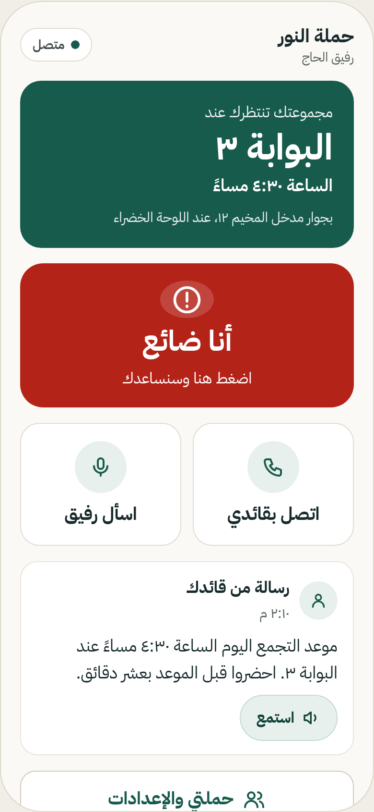
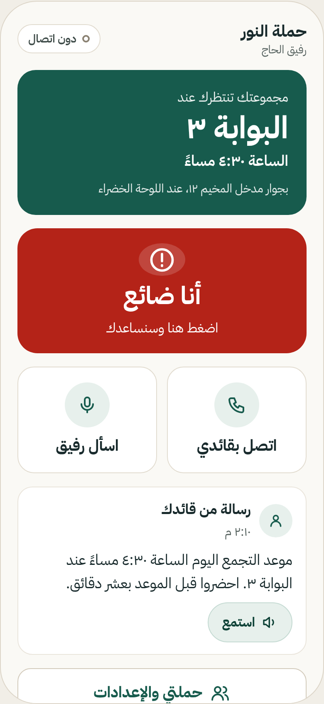
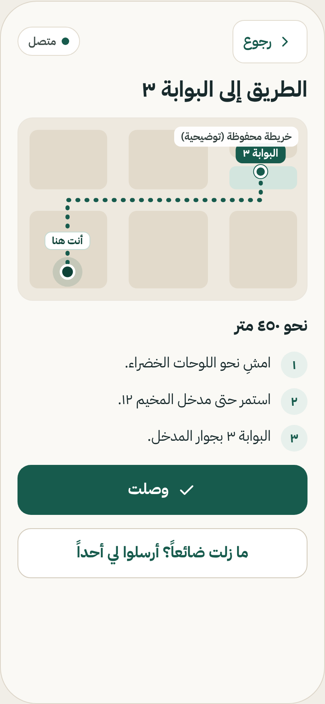
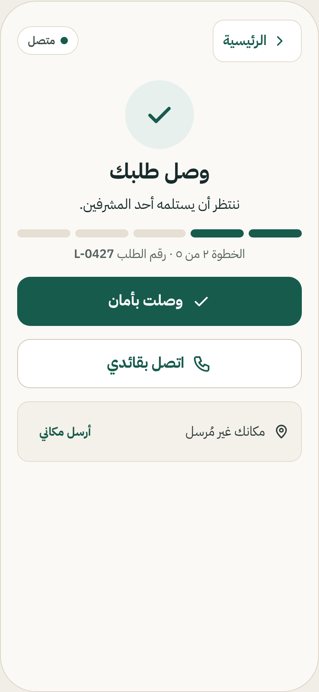
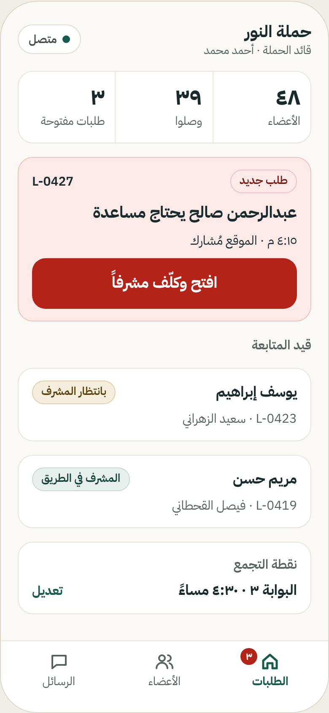

<div align="center">


# Rafiq Alhaj · رفيق الحاج

**Keeps every pilgrim connected to their campaign leader, even without internet.**

يوصل تعليمات قائد الحملة لكل حاج، ويرشده إلى مجموعته حتى دون إنترنت

🏆 **Top 20 winner** · Hajj Future Innovations Camp 2026 (Hajj Conference & Exhibition, 6th edition)

[**Live demo**](https://rafiq-alhaj-nine.vercel.app) · [Demo guide](DEMO.md) · [Screen designs](design/INDEX.md)

</div>

---

## The problem

In the crowds of the holy sites, a pilgrim can get separated from their campaign and struggle to find the way back or reach the leader, especially when the network is weak or down. During Hajj 1446H, more than 18,000 lost pilgrims had to be guided back to their destinations.

## What it does

**For pilgrims**
- **Works offline.** Installable PWA: the app shell, fonts and campaign info are cached on the phone, so the home screen opens with no connection.
- **"I'm lost" button.** Shows the direction and distance to the assembly point using GPS only (no map download needed), or sends a help request to the leader.
- **Help requests that never get lost.** Requests are queued on the device and sent automatically on reconnect (idempotent, so never duplicated). If there is no internet at all, a one-tap SMS reaches the leader.
- **Leader messages** in the pilgrim's language (Arabic, English, Urdu, Indonesian), confirmed with one tap: "Understood".
- Built for an 80-year-old and a 15-year-old alike: one home screen, big buttons, every task in two taps, large-text option.

**For campaign leaders**
- Send instructions with auto-translation preview and ready templates.
- Live counters: who understood each message, who has arrived at the assembly point.
- Help request inbox with status tracking (received → on the way → resolved).
- Change the assembly time and every pilgrim sees it instantly.

## Screenshots

| Pilgrim home | Offline | I'm lost | Help request | Leader requests |
|---|---|---|---|---|
|  |  |  |  |  |

All names, numbers and maps in the screens are sample data.

## Tech stack

| Layer | Tools |
|---|---|
| Frontend | React 19, Vite, Tailwind CSS 4, React Router |
| Offline | vite-plugin-pwa (precached shell, self-hosted fonts), on-device request queue |
| Backend | Supabase: Postgres with Row Level Security, Realtime, anonymous auth, Edge Functions |
| Translation | Supabase Edge Function calling an LLM API (never called from the browser), with manual fallback |
| Maps | Leaflet (shown only when tiles can load; GPS direction works without it) |
| Hosting | Vercel |

## Run locally

```bash
npm install
npm run dev   # http://localhost:5173
```

Create `.env.local` with:

```
VITE_SUPABASE_URL=...
VITE_SUPABASE_ANON_KEY=...
```

See [DEMO.md](DEMO.md) for demo join codes and a 60-second walkthrough.

## Validation

- 15 interviews with pilgrims and Hajj service workers
- ~20 people tried the app on their own phones during the camp

## Team Sanad · فريق سند

Osama Alghamdi (team lead) · Ameer Alghamdi (product development) · Faisal Alorabi (UI design) · Abdulmalik Alzahrani (field expertise) · Abdullah Almazroui · Abdullah Alahmadi

Supervised by Dr. Mohammad Alahmadi, University of Jeddah.
